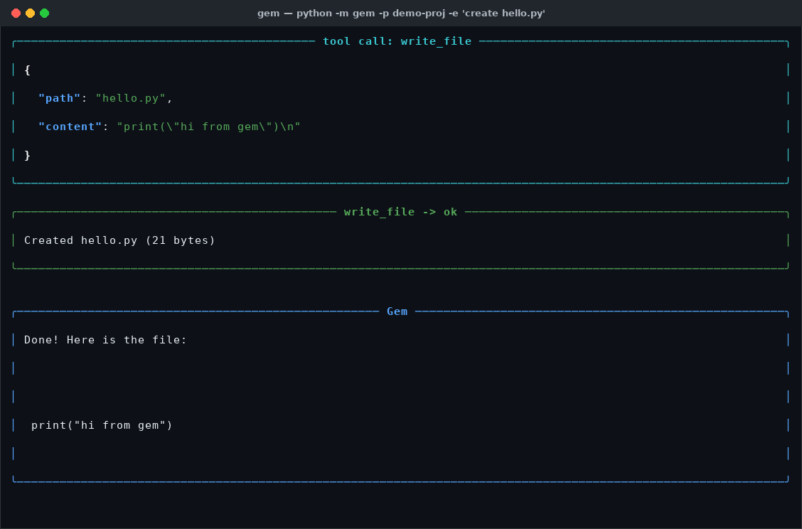
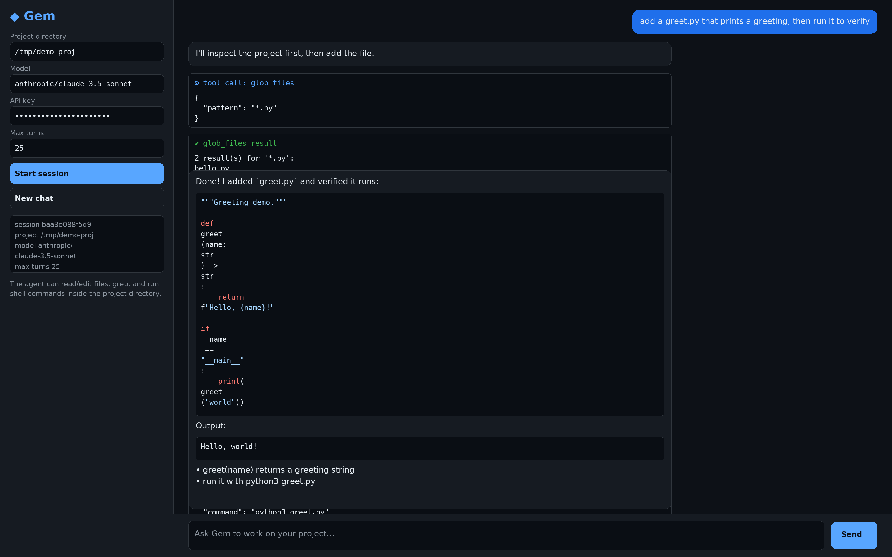

# Gem

Gem is an AI coding agent in Python with **both** a terminal CLI and a full web
frontend. It converses with you, reads, creates, edits and deletes files inside a
project folder you choose, searches the codebase (grep/glob), lists directories,
and runs shell commands — all through a multi-step agent loop (think → act →
observe → repeat) driven by an LLM on [OpenRouter](https://openrouter.ai) via its
OpenAI-compatible API.

## Preview

**Terminal CLI** — tool calls, results, and Markdown answers in the terminal:



**Web UI** (`gem --serve`) — live-streamed chat with tool-call blocks and
syntax-highlighted code:



## Features

- **Agent loop**: the model calls tools (OpenAI tool-calling format); each result is
  fed back until the model answers without tools (or `--max-turns` is reached).
- **Tools** (all confined to `--project-dir`):
  - `read_file` (offset/limit), `write_file`, `edit_file` (exact search/replace),
    `delete_file`, `list_dir` (flat or recursive)
  - `grep` (regex, include filter, context lines), `glob_files`
  - `run_command` (shell, with a denylist for dangerous commands, timeouts,
    output truncation, and API-key redaction)
- **OpenRouter client** (`gem/client.py`): raw `httpx`, non-streaming **and** SSE
  streaming, `tools` in the request body, proper error handling.
- **Config**: `OPENROUTER_API_KEY` / `OPENROUTER_MODEL` from the environment or a
  `.env` file; CLI flags override everything.
- **Pretty output**: `rich` — streamed tokens live, tool calls/results in panels,
  final answers rendered as Markdown (fenced, syntax-highlighted code blocks).

## Install

```bash
pip install -r requirements.txt        # or: pip install -e .
pip install -r requirements-dev.txt    # adds pytest
```

Requires Python 3.10+.

## Configure

```bash
export OPENROUTER_API_KEY=sk-or-...    # or put it in a .env file (see .env.example)
# optional:
export OPENROUTER_MODEL=anthropic/claude-3.5-sonnet
```

## Usage

```bash
# interactive REPL in the current directory
gem

# pick the project folder and model
gem --project-dir /path/to/project --model anthropic/claude-3.5-sonnet

# one-shot task, then exit
gem -p /path/to/project -e "add a healthcheck endpoint to app.py"

# other flags
gem --api-key sk-or-... --max-turns 40 --no-stream
gem --list-models     # list models available on OpenRouter
gem --version
```

Inside the REPL: `/help`, `/clear` (reset conversation), `/exit` (quit).

### Web UI

```bash
gem --serve --port 8000     # then open http://127.0.0.1:8000
```

The web UI (FastAPI + vanilla JS, served loopback-only) offers a chat page where you
set the project directory, model, API key and max turns. Assistant tokens stream in
live over SSE, tool calls and results render as collapsible blocks, and final
answers are rendered as Markdown with syntax-highlighted code blocks.

API: `POST /api/sessions` (create), `POST /api/sessions/{id}/chat` (SSE event
stream: `token` / `tool_call` / `tool_result` / `status` / `final` / `error`),
`GET /api/sessions/{id}/history`, `POST /api/sessions/{id}/reset`,
`DELETE /api/sessions/{id}`, `GET /api/health`.

You can also run it as a module: `python -m gem ...`

## CLI flags

| Flag | Description | Default |
| --- | --- | --- |
| `--project-dir`, `-p` | Project folder the agent works in (sandbox root) | `.` |
| `--model`, `-m` | OpenRouter model id | `OPENROUTER_MODEL` or `anthropic/claude-3.5-sonnet` |
| `--api-key` | OpenRouter API key | `OPENROUTER_API_KEY` env / `.env` |
| `--max-turns` | Max tool-calling steps per task | `25` |
| `--execute`, `-e` | Run one task non-interactively and exit | — |
| `--no-stream` | Disable SSE streaming | off (streaming on) |
| `--list-models` | List OpenRouter models and exit | — |
| `--serve` | Start the web UI instead of the REPL | off |
| `--host` / `--port` | Bind address for `--serve` | `127.0.0.1` / `8000` |

## Architecture

```
gem/
  cli.py          typer + rich CLI, REPL, one-shot mode, --serve
  config.py       env/.env loading + precedence (CLI > env > .env > default)
  client.py       OpenRouter OpenAI-compatible client (httpx; stream + non-stream)
  agent.py        agent loop as an event stream (shared by CLI and web UI)
  server.py       FastAPI app: sessions + SSE chat endpoint + static web UI
  web/            browser frontend (index.html, app.js, style.css)
  prompts.py      system prompt
  tools/
    base.py       Tool / ToolRegistry (schemas, dispatch, redaction, truncation)
    filesystem.py read/write/edit/delete/list, confined to the project dir
    search.py     grep + glob over the project
    shell.py      run_command with safety denylist, timeout, cwd confinement
tests/            pytest suite (no network needed; httpx MockTransport + fake client)
```

Request shape sent to `https://openrouter.ai/api/v1/chat/completions`:

```json
{
  "model": "anthropic/claude-3.5-sonnet",
  "messages": [{"role": "user", "content": "..."}],
  "tools": [{"type": "function", "function": {"name": "read_file", "description": "...", "parameters": {"type": "object", "properties": {}, "required": []}}}],
  "stream": true
}
```

with headers `Authorization: Bearer <OPENROUTER_API_KEY>` and `Content-Type: application/json`.

## Safety

- File tools resolve every path and refuse anything outside `--project-dir`.
- `run_command` runs with the project dir as cwd, blocks dangerous commands
  (`rm -rf /`, `mkfs`, `dd of=/dev/...`, `sudo`, `curl | sh`, fork bombs, ...),
  enforces a timeout, and truncates output.
- The API key is redacted from all tool output sent back to the model.

## Tests

```bash
python -m pytest -q
```
